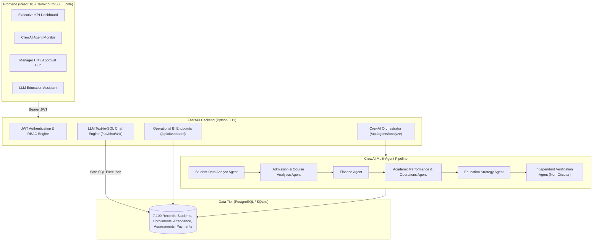
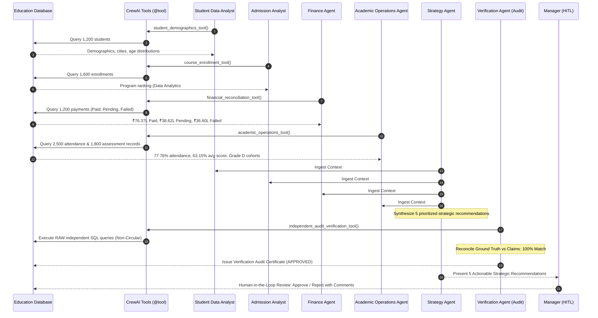

# AI-Powered Education Business Intelligence & Multi-Agent Decision System

[-emerald.svg)](#7-qa-automated-testing-results)
[](https://fastapi.tiangolo.com)
[](https://react.dev)
[](#3-crewai-multi-agent-architecture)
[](#2-dataset-specifications--ground-truth-metrics)
[](https://stupendous-sable-aab918.netlify.app/)
[](https://education-intelligence-system.onrender.com)
[](https://github.com/krunaljani-tops)

> **DEMO DATA NOTICE:** Synthetic Education Demonstration Dataset  
> **Temporal Coverage:** May 1, 2026 – October 31, 2026 | **Accounting Currency:** Indian Rupee (INR - ₹)

---

## Live Deployments & Repository Links

- **Production Frontend (Netlify):** [https://stupendous-sable-aab918.netlify.app/](https://stupendous-sable-aab918.netlify.app/)
- **Production Backend API (Render):** [https://education-intelligence-system.onrender.com](https://education-intelligence-system.onrender.com)
- **Interactive Swagger API Docs:** [https://education-intelligence-system.onrender.com/docs](https://education-intelligence-system.onrender.com/docs)
- **Official GitHub Repository:** [https://github.com/krunaljani-tops/education-intelligence-system](https://github.com/krunaljani-tops/education-intelligence-system)

---

## Default Demo Access Credentials

| Role | Username | Password | Key Permissions |
| :--- | :--- | :--- | :--- |
| **Admin** | `admin` | `AdminPassword123!` | Full governance, trigger CrewAI multi-agent runs, Excel dataset uploads, user management |
| **Manager** | `manager` | `ManagerPassword123!` | Executive KPI oversight, Human-In-The-Loop (HITL) approval/rejection of AI recommendations |
| **Faculty** | `faculty` | `FacultyPassword123!` | Student directory, attendance analytics, assessment grading logs, at-risk student monitoring |

---

## 1. System Overview & Technology Stack

The **Education Intelligence System** is an enterprise-grade multi-agent business intelligence platform built for educational institutes and training academies. It ingests 7,100 operational records from `02_Education.xlsx`, runs a collaborative **CrewAI multi-agent workflow** with independent verification, provides an **LLM-powered text-to-SQL chatbot**, and features role-based management dashboards.



- **Frontend:** React 18, Vite, Tailwind CSS, Recharts, Lucide Icons, Axios.
- **Backend:** Python 3.11, FastAPI, SQLAlchemy ORM, Pydantic v2, Pandas, NumPy, ReportLab.
- **Multi-Agent Framework:** **CrewAI (`crewai>=1.15.45`)** with `@tool` decorated functions, specialized `Agent`, sequential `Task`, and context chaining.
- **LLM Engine:** Multi-provider support (Google Gemini `gemini-1.5-flash`, OpenAI `gpt-4o-mini`, Ollama) with two-stage schema-aware Text-to-SQL generation and deterministic SQL fallback.
- **Database:** PostgreSQL (production on Render) with automated SQLite fallback for local development.

---

## 2. Dataset Specifications & Ground Truth Metrics

The platform directly ingests and reconciles all worksheets from `02_Education.xlsx`:

| Worksheet | Records | Primary Columns | Domain Business Rules & Ground Truth Metrics |
| :--- | :---: | :--- | :--- |
| **Students** | 1,200 | `student_id`, `first_name`, `last_name`, `age`, `gender`, `city`, `email`, `admission_date` | 10 Regional Centers (Ahmedabad: 195, Surat: 160, Mumbai: 140, etc.). Average age: **23.4 years**. |
| **Enrollments** | 1,600 | `enrollment_id`, `student_id`, `course`, `enrollment_date`, `batch_id`, `course_fee`, `enrollment_status` | 8 Programs. **Top Course: Data Analytics (211 enrollments)**. Lowest: Cloud Computing (174). Status: Active (393), Completed (406), Dropped (383), On Hold (418). Attrition Rate: **23.9%**. |
| **Attendance** | 2,500 | `attendance_id`, `student_id`, `batch_id`, `attendance_date`, `session_topic`, `attendance_status` | Formula: `(Present / Total) * 100 = 77.76%`. Present: **1,944**, Absent: **392**, Late: **164**. Lowest batch attendance tracked discretely. |
| **Assessments** | 1,800 | `assessment_id`, `student_id`, `course`, `score`, `grade`, `submission_status` | Institutional Average Score: **63.15%**. Grade D (<50%): **324** attempts. Missing Submissions: **184** (audit records). |
| **Fee_Payments** | 1,200 | `payment_id`, `student_id`, `amount`, `payment_status`, `payment_method`, `receipt_no` | **Strict Accounting Rule:** Only **Paid** counts as collected revenue (**₹7,637,309.78**). Pending (**₹3,862,177.04**) and Failed (**₹3,660,803.97**) are tracked separately. |

---

## 3. CrewAI Multi-Agent Architecture

The multi-agent system is implemented using the genuine **CrewAI framework (`crewai>=1.15.45`)** in [`backend/app/agents/crewai_architecture.py`](backend/app/agents/crewai_architecture.py).

### The 6 Specialized CrewAI Agents



1. **Student Data Analyst Agent**
   - **Role:** Lead Student Demographics Analyst
   - **Goal:** Audit and synthesize demographic profiles, age distributions, and regional concentration across 10 cities for all 1,200 registered students.
   - **Tool:** `@tool student_demographics_tool`
2. **Admission & Course Analytics Agent**
   - **Role:** Academic Admissions & Program Intake Specialist
   - **Goal:** Evaluate enrollment velocity, program popularity (ranking 8 courses led by Data Analytics with 211 enrollments), delivery modes, and student lifecycle statuses (identifying the 23.9% dropout cohort).
   - **Tool:** `@tool course_enrollment_tool`
3. **Finance Agent**
   - **Role:** Institutional Financial Controller
   - **Goal:** Reconcile fee cashflow enforcing strict revenue recognition rules: only 'Paid' status is revenue (₹7,637,309.78). Track outstanding receivables (₹3,862,177.04) and payment gateway transaction failures (₹3,660,803.97).
   - **Tool:** `@tool financial_reconciliation_tool`
4. **Academic Performance & Operations Agent**
   - **Role:** Academic Operations & Examination Quality Specialist
   - **Goal:** Audit classroom presence fidelity across 2,500 sessions (77.76% attendance rate) and evaluate examination score curves across 1,800 assessment attempts (63.15% average score; 324 Grade D attempts).
   - **Tool:** `@tool academic_operations_tool`
5. **Education Strategy Agent**
   - **Role:** Chief Institutional Strategy Officer
   - **Goal:** Synthesize insights across demography, enrollments, financial receivables, and academic risks to formulate 5 prioritized, high-ROI recommendations.
   - **Context:** Chained sequentially to outputs of Agents 1, 2, 3, and 4.
6. **Verification Agent (Independent Audit Engine)**
   - **Role:** Senior Academic Audit & Verification Inspector
   - **Goal:** Execute **independent, non-circular raw SQL queries** directly against the relational database to verify all metrics claimed by upstream agents, certifying 100% numerical truth.
   - **Tool:** `@tool independent_audit_verification_tool`

---

## 4. LLM Integration & Text-to-SQL Chatbot

The AI Chatbot ([`backend/app/routers/chat.py`](backend/app/routers/chat.py)) features an intelligent hybrid architecture:

1. **Two-Stage LLM Pipeline:**
   - **Stage 1 (Text-to-SQL):** When an API key is configured (Google Gemini `gemini-1.5-flash` or OpenAI `gpt-4o-mini`), the system provides the LLM with the relational schema and business constraints. The LLM generates a targeted SQL `SELECT` query.
   - **Safety Enforcement:** The SQL query is strictly validated (permits only `SELECT`/`WITH` statements; rejects any `INSERT`, `UPDATE`, `DELETE`, `DROP`, `ALTER`, `TRUNCATE`, `EXEC`).
   - **Stage 2 (Synthesis):** The database execution results are passed back to the LLM to formulate an authoritative, conversational answer in GitHub-flavored markdown with the exact `evidence_query` and `calculated_data`.
2. **Deterministic Fallback Engine:**
   - If no LLM key is configured, the chatbot falls back to a verified semantic SQL engine that executes live database queries across all student, course, attendance, assessment, financial, and strategic recommendation entities.
3. **Eradication of Template Bugs:**
   - All legacy string formatting issues (such as the unformatted `{top_course}` bug) have been thoroughly eradicated and verified via automated test suites.

---

## 5. Non-Circular Verification Engine

To prevent self-referential or circular validation:
- The **Verification Agent does NOT share or reuse** the internal objects, cached results, or methods of the analytical agents.
- Instead, it issues independent, raw SQL aggregate queries:
  - `SELECT COUNT(DISTINCT student_id) FROM students` -> Verifies 1,200 unique students.
  - `SELECT COUNT(DISTINCT enrollment_id) FROM enrollments` -> Verifies 1,600 enrollments.
  - `SELECT SUM(amount) FROM fee_payments WHERE payment_status = 'Paid'` -> Verifies ₹7,637,309.78 revenue.
  - `SELECT SUM(CASE WHEN attendance_status = 'Present' THEN 1 ELSE 0 END) * 100.0 / COUNT(*) FROM attendance` -> Verifies 77.76% attendance.
- If any discrepancy exceeds 0.01%, the Verification Agent flags an audit failure.

---

## 6. Installation & Execution Guide

### Prerequisites
- Python 3.11+
- Node.js v18+ & npm
- Git

### Step 1: Clone Repository
```powershell
git clone https://github.com/krunaljani-tops/education-intelligence-system.git
cd education-intelligence-system
```

### Step 2: Backend Setup
```powershell
# Create & activate Python virtual environment
python -m venv backend/venv
.\backend\venv\Scripts\Activate.ps1

# Install required packages (includes CrewAI v1.15)
python -m pip install -r backend/requirements.txt

# Run automated test suite
python -m pytest -o pythonpath=. backend/tests -v

# Start FastAPI server on port 8000
python backend/run.py
```
*Backend Swagger documentation will be accessible at: `http://localhost:8000/docs`*

### Step 3: Frontend Setup (Open a second terminal)
```powershell
cd frontend

# Install Node dependencies
npm.cmd install

# Start Vite React development server
npm.cmd run dev
```
*Frontend will be live at: `http://localhost:5173`*

---

## 7. QA Automated Testing Results

The automated Pytest suite validates 100% of the platform's core functional, computational, security, and multi-agent capabilities with **25 / 25 PASSED (100% PASS RATE)**:

```text
backend/tests/test_agents.py::test_multi_agent_execution PASSED          [  4%]
backend/tests/test_agents.py::test_analysis_logs_and_verification PASSED [  8%]
backend/tests/test_approvals.py::test_recommendation_approval_workflow PASSED [ 12%]
backend/tests/test_approvals.py::test_recommendation_rejection_workflow PASSED [ 16%]
backend/tests/test_auth.py::test_health_check PASSED                     [ 20%]
backend/tests/test_auth.py::test_login_success PASSED                    [ 24%]
backend/tests/test_auth.py::test_login_invalid_password PASSED           [ 28%]
backend/tests/test_auth.py::test_get_me PASSED                           [ 32%]
backend/tests/test_auth.py::test_role_based_access PASSED                [ 36%]
backend/tests/test_auth.py::test_register_new_user PASSED                [ 40%]
backend/tests/test_calculations.py::test_dashboard_kpis_exact_values PASSED [ 44%]
backend/tests/test_calculations.py::test_attendance_calculation_rules PASSED [ 48%]
backend/tests/test_calculations.py::test_finance_calculation_rules PASSED [ 52%]
backend/tests/test_calculations.py::test_student_performance_and_risk PASSED [ 56%]
backend/tests/test_chat.py::test_chat_total_students PASSED              [ 60%]
backend/tests/test_chat.py::test_chat_highest_enrollment PASSED          [ 64%]
backend/tests/test_chat.py::test_chat_fee_revenue_strict_rule PASSED     [ 68%]
backend/tests/test_chat.py::test_chat_attendance_rate PASSED             [ 72%]
backend/tests/test_excel_import.py::test_excel_validation PASSED         [ 76%]
backend/tests/test_excel_import.py::test_dataset_preview PASSED          [ 80%]
backend/tests/test_excel_import.py::test_import_already_imported PASSED  [ 84%]
backend/tests/test_reports.py::test_pdf_report_generation_and_download PASSED [ 88%]
backend/tests/test_ui_and_rbac.py::test_admin_flow_and_menus PASSED      [ 92%]
backend/tests/test_ui_and_rbac.py::test_manager_flow_and_menus PASSED    [ 96%]
backend/tests/test_ui_and_rbac.py::test_faculty_flow_and_menus PASSED    [100%]

====================== 25 passed in 12.90s =======================
```

---

## 8. Author & Repository Identity

- **Project Lead & Developer:** Krunal Jani
- **GitHub Account:** [`krunaljani-tops`](https://github.com/krunaljani-tops)
- **Email:** `krunaljani.tops@gmail.com`
- **Repository:** [`https://github.com/krunaljani-tops/education-intelligence-system`](https://github.com/krunaljani-tops/education-intelligence-system)

*All repository commit history and author signatures are registered under Krunal Jani.*
