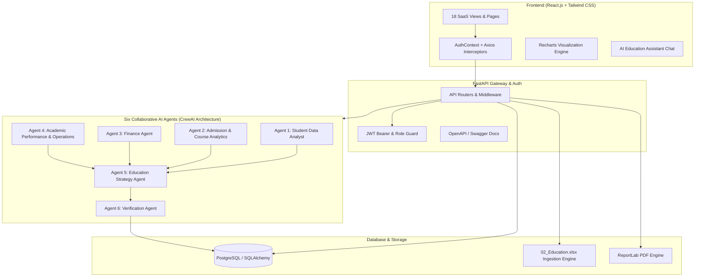

# System Architecture Specification
## AI-Powered Education Business Intelligence & Student Performance System

### 1. High-Level Architecture Overview
The system follows a modern decoupled SaaS architecture with:
- **Presentation Layer:** React.js Single Page Application styled with Tailwind CSS, Recharts for dynamic visual intelligence, Axios for authenticated communication, and Lucide icons.
- **Application & API Layer:** Python 3.11 with FastAPI delivering asynchronous, high-throughput REST APIs with automatic OpenAPI (Swagger) documentation, JWT authentication, and role-based access control (Admin, Manager, Faculty).
- **Multi-Agent Orchestration Layer:** Six collaborative AI agents orchestrated sequentially with dependency passing, deterministic SQL verification, and LLM reasoning via Gemini API, OpenAI, or offline analytical mode.
- **Data Persistence Layer:** PostgreSQL 17 (with automated SQLite fallback for local developer agility) managed via SQLAlchemy ORM with indexes, foreign key constraints, and relational schemas.
- **Reporting Engine:** ReportLab PDF generating audit-ready, executive education intelligence reports including charts, KPI summaries, verified statistics, and management approvals.

### 2. Multi-Agent Pipeline Details
1. **Agent 1: Student Data Analyst**:
   - Queries student demographics, age groups, gender balance, cities, and education levels.
   - Computes unique student totals and admission velocity.
2. **Agent 2: Admission & Course Analytics**:
   - Analyzes course enrollment counts, delivery mode distributions (Hybrid, Offline, Online), batch enrollments, and status breakdowns (Active, Completed, Dropped, On Hold).
3. **Agent 3: Finance Agent**:
   - Calculates successfully collected revenue (strictly `Paid` transactions), pending liabilities, and failed transactions.
   - Evaluates payment method preferences (Card, UPI, Cash, Bank Transfer) and installment progression.
4. **Agent 4: Academic Performance & Operations**:
   - Calculates attendance percentages: `(Present Records / Total Records) * 100`, late arrivals, and absences.
   - Calculates assessment averages, grade distributions (A, B, C, D), and tracks missing or late submissions.
5. **Agent 5: Education Strategy Agent**:
   - Receives aggregated outputs from Agents 1–4.
   - Generates actionable institutional recommendations with Problem Identified, Dataset Evidence, Recommended Action, Expected Benefit, Priority, and Confidence Level.
6. **Agent 6: Verification Agent**:
   - Cross-checks all numerical outputs against live database queries using strict tolerance.
   - Validates totals, detects conflicting statements, flags ungrounded claims, and formally assigns an `APPROVED` or `REJECTED` status to the intelligence run.

### 3. Deployment Architecture
- **Frontend (Netlify):** Built with Vite, deployed to Netlify via `netlify.toml` with single-page application redirects (`/* -> /index.html 200`) and environment variable injection (`VITE_API_URL`).
- **Backend (Render):** Docker / Python web service configured via `render.yaml` with Gunicorn/Uvicorn, health checks at `/api/health`, and managed PostgreSQL instance.
