# Entity-Relationship (ER) Diagram
## AI-Powered Education Business Intelligence & Student Performance System

### Overview
This document specifies the relational data model for the Education Business Intelligence System, integrating the operational sheets from `02_Education.xlsx` alongside the SaaS operational tables (users, datasets, AI agent executions, recommendations, approval history, reports).

```mermaid
erDiagram
    STUDENTS ||--o{ ENROLLMENTS : "has"
    STUDENTS ||--o{ ATTENDANCE : "attends"
    STUDENTS ||--o{ ASSESSMENTS : "takes"
    STUDENTS ||--o{ FEE_PAYMENTS : "makes"
    
    USERS ||--o{ APPROVAL_HISTORY : "acts_on"
    USERS ||--o{ GENERATED_REPORTS : "requests"
    
    UPLOADED_DATASETS ||--o{ ANALYSIS_HISTORY : "triggers"
    ANALYSIS_HISTORY ||--o{ AGENT_EXECUTION_LOGS : "logs"
    ANALYSIS_HISTORY ||--o{ AI_RECOMMENDATIONS : "generates"
    AI_RECOMMENDATIONS ||--o{ APPROVAL_HISTORY : "audits"

    STUDENTS {
        string student_id PK "Unique Student ID (e.g., STU00001)"
        string student_name "Full Name"
        int age "Age (16-35)"
        string gender "Male, Female, Other"
        string city "City name"
        string email "Unique Email Address"
        date admission_date "Date of Admission (2026-05-01 to 2026-10-31)"
        string education_level "Diploma, Graduate, Undergraduate, Professional"
        datetime created_at "Record Timestamp"
    }

    ENROLLMENTS {
        string enrollment_id PK "Unique Enrollment ID (e.g., ENR00001)"
        string student_id FK "References STUDENTS.student_id"
        string course "Enrolled Course Title (8 courses)"
        date enrollment_date "Date of Enrollment"
        string batch_id "Batch Identifier (e.g., BAT001-BAT045)"
        float course_fee "Course Fee in INR (₹)"
        string enrollment_status "Active, Completed, Dropped, On Hold"
        string delivery_mode "Hybrid, Offline, Online"
    }

    ATTENDANCE {
        string attendance_id PK "Unique Attendance ID (e.g., ATT00001)"
        string student_id FK "References STUDENTS.student_id"
        string batch_id "Batch Identifier (BAT001-BAT045)"
        date attendance_date "Session Date"
        string session_topic "Curriculum Topic (7 topics)"
        string attendance_status "Present, Late, Absent"
        int session_duration_minutes "60, 90, 120 minutes"
    }

    ASSESSMENTS {
        string assessment_id PK "Unique Assessment ID (e.g., ASM00001)"
        string student_id FK "References STUDENTS.student_id"
        string course "Course Name"
        date assessment_date "Examination Date"
        string assessment_type "Assignment, Mock Interview, Project, Quiz"
        float score "Attained Score"
        float max_score "Maximum Possible Score (100)"
        string grade "A (85+), B (70-84), C (50-69), D (<50)"
        string submission_status "Submitted, Late, Missing"
    }

    FEE_PAYMENTS {
        string payment_id PK "Unique Payment ID (e.g., PAY00001)"
        string student_id FK "References STUDENTS.student_id"
        date payment_date "Transaction Date"
        float amount "Transaction Amount in INR (₹)"
        string payment_method "UPI, Card, Cash, Bank Transfer"
        string payment_status "Paid, Pending, Failed"
        int installment_no "Installment Number (1-6)"
        string receipt_no "Receipt Reference Number (e.g., REC000001)"
    }

    UPLOADED_DATASETS {
        int id PK "Auto-increment ID"
        string filename "Uploaded File Name"
        int file_size "Bytes"
        string checksum "SHA-256 Checksum"
        int student_count "Imported Students"
        int enrollment_count "Imported Enrollments"
        int attendance_count "Imported Attendance"
        int assessment_count "Imported Assessments"
        int payment_count "Imported Payments"
        string status "Validated, Imported, Failed"
        datetime uploaded_at "Upload Timestamp"
        string uploaded_by "Username / Admin"
    }

    ANALYSIS_HISTORY {
        string id PK "UUID Analysis Run ID"
        string title "Run Title / Description"
        string status "RUNNING, COMPLETED, FAILED"
        int total_agents "6"
        int completed_agents "Number of completed agents"
        string verification_status "APPROVED, REJECTED, WARNING"
        json raw_metrics "Snapshot of KPIs & Analytical Totals"
        json executive_summary "High level agent conclusions"
        datetime started_at "Execution Start Time"
        datetime completed_at "Execution End Time"
    }

    AGENT_EXECUTION_LOGS {
        int id PK "Log Entry ID"
        string analysis_id FK "References ANALYSIS_HISTORY.id"
        string agent_name "Agent Identifier (e.g., Student Data Analyst)"
        string agent_role "Role Description"
        string status "RUNNING, COMPLETED, FAILED"
        datetime start_time "Agent Start Time"
        datetime completion_time "Agent Completion Time"
        text input_context "Input Data Summary"
        text output_summary "Key Analytical Findings"
        json structured_output "Structured JSON results"
        string verification_status "VERIFIED, UNVERIFIED, CONFLICT"
    }

    AI_RECOMMENDATIONS {
        int id PK "Recommendation ID"
        string analysis_id FK "References ANALYSIS_HISTORY.id"
        string agent_source "Agent Name"
        string category "Academic, Financial, Operational, Retention"
        string problem_identified "Detailed Problem Description"
        text dataset_evidence "Data Metrics and Query Proof"
        text recommended_action "Actionable Institutional Proposal"
        text expected_benefit "Anticipated Quantitative/Qualitative Impact"
        string priority "HIGH, MEDIUM, LOW"
        float confidence_level "Confidence Score (0.00 - 1.00)"
        string status "PENDING, APPROVED, REJECTED"
        datetime created_at "Creation Timestamp"
    }

    APPROVAL_HISTORY {
        int id PK "Approval Audit ID"
        int recommendation_id FK "References AI_RECOMMENDATIONS.id"
        int user_id FK "References USERS.id"
        string action "APPROVED, REJECTED"
        text manager_comments "Feedback or Operational Directives"
        datetime reviewed_at "Decision Timestamp"
    }

    GENERATED_REPORTS {
        int id PK "Report ID"
        string analysis_id FK "References ANALYSIS_HISTORY.id"
        string report_title "Title of Report"
        string file_path "Path to generated PDF file"
        int file_size "Size in bytes"
        datetime generated_at "Generation Timestamp"
        string generated_by "Admin/Manager username"
    }

    USERS {
        int id PK "User ID"
        string username "Unique Username"
        string email "Unique User Email"
        string hashed_password "Bcrypt Password Hash"
        string full_name "Full Name"
        string role "Admin, Manager, Faculty"
        boolean is_active "Active Status"
        datetime created_at "Registration Timestamp"
    }
```

### Table Relationships & Integrity Rules
1. **Primary Foreign Key Anchor**: `student_id` is the primary foreign key across `enrollments`, `attendance`, `assessments`, and `fee_payments`, guaranteeing full referential integrity to `students.student_id`.
2. **Cascades & Deletion Rules**: All operational tables cascade safely on student deletion in a testing environment while enforcing integrity constraints in production.
3. **Financial Ledger Isolation**: As mandated by the dataset rules, `fee_payments` records contain `amount`, `payment_status` (Paid, Pending, Failed), and `student_id`, but cannot be subtracted directly from `course_fee` due to unmapped enrollment-to-payment identifiers.
